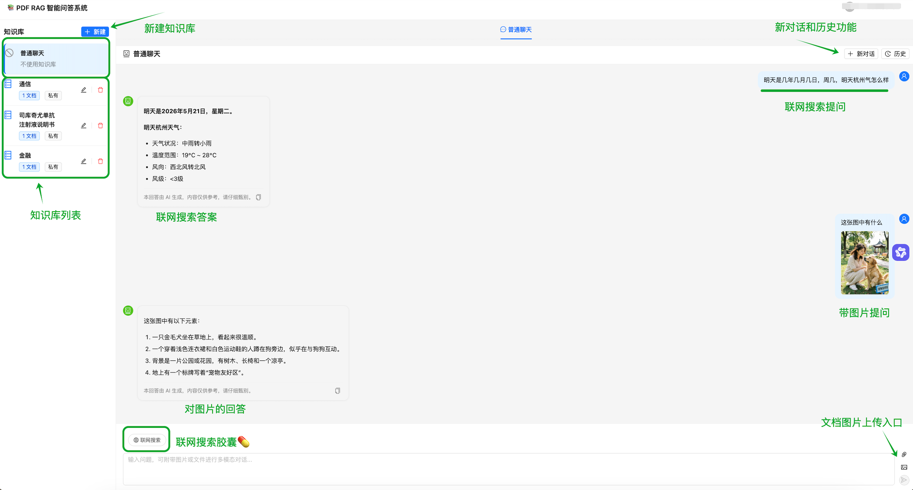

# PDF RAG 智能问答系统 | PDF Knowledge Base QA with RAG

> 🚀 基于 DeepSeek + LangChain + FAISS 构建的**全栈 RAG（Retrieval-Augmented Generation）智能问答系统**，支持多知识库管理、混合检索、流式对话、OCR 扫描件识别，开箱即用的企业级文档问答解决方案。

[](https://python.org)
[](https://fastapi.tiangolo.com)
[](https://react.dev)
[](https://typescriptlang.org)
[](https://langchain.com)
[](https://deepseek.com)
[](LICENSE)

**PDF RAG Assistant** 是一个面向学习者和开发者的开源 RAG 全栈项目，涵盖文档解析（PDF/DOCX/TXT/Markdown）、向量化存储（FAISS）、混合检索（向量 + BM25）、LLM 流式生成（DeepSeek/GLM）、多模态理解（图片/文件）、语义缓存、引用溯源等完整 RAG 工程实践。适合用于学习 LangChain、RAG 架构、向量数据库、Prompt Engineering、SSE 流式通信等技术。

**Keywords**: RAG, Retrieval-Augmented Generation, PDF 问答, 知识库问答, LangChain, FAISS, DeepSeek, 向量检索, 文档智能, OCR, 混合检索, 流式对话, FastAPI, React, 全栈项目, AI 应用开发, LLM 应用

## 系统截图

知识库问答

普通聊天

文档管理


### 核心亮点

- 🔍 **混合检索**：向量相似度 + BM25 关键词检索，提升召回率
- 📊 **表格感知**：针对 PDF 中的表格数据优化解析，保留结构信息
- 🖼️ **OCR 支持**：扫描件 PDF 自动 tesseract 文字识别（本地处理，不消耗 token）
- 🌐 **联网搜索**：普通聊天模式支持一键开启联网搜索（glm-4-flash-250414 + web_search 工具），获取实时信息（免费）
- 📎 **文件理解**：上传 PDF/Word/Excel 等文件，智谱 AI 文件解析后直接问答（免费）
- 🖼️ **图片理解**：上传图片进行多模态对话，GLM-4V-Flash 免费图片识别
- 🤖 **智能路由**：自动根据输入类型选择最优模型（有图 → 多模态模型，纯文本 → 文本模型）
- 💬 **流式响应**：基于 SSE 实时流式输出，体验流畅
- 📖 **引用溯源**：回答关联原文段落，点击即可定位到源文档
- 💾 **语义缓存**：相似问题命中缓存，显著降低 API 调用成本
- 🔐 **多租户隔离**：每个知识库独立 FAISS 索引，数据互不干扰
- 🛡️ **鉴权与数据归属**：所有业务接口强制 JWT 认证（未登录 401），知识库/会话归属创建者，他人私有库 403 拒绝
- 🧱 **Service 分层**：业务逻辑下沉 services/ 层，领域异常经全局 handler 统一转 HTTP（404/403/400/409），路由层只留参数注入与响应组装；service 函数可脱离 HTTP 直接调用（Agent 工具基座预演）
- 🧰 **Agent 工具基座**：意图分类三路接力（rag/tool/plain），tool 分支驱动 7 个只读工具（检索/计算/时间/订单模拟等）的手写 bind_tools 循环；三重保险防失控：3 轮决策上限、单轮 10 次调用截断、双超时（单工具 10s / LLM 15s）+ 连续同类错误熔断；工具身份经 contextvar 注入，与 RAG 同源权限防线，前端可折叠日志面板展示每步调用

## 技术栈

| 层级     | 技术                                       |
| -------- | ------------------------------------------ |
| 后端     | Python 3.9+ / FastAPI + Uvicorn            |
| RAG 编排 | LangChain + LCEL                           |
| LLM      | DeepSeek API（兼容 OpenAI 格式）           |
| 嵌入     | text-embedding-v3 / BAAI/bge-small-zh-v1.5 |
| 向量库   | FAISS（多知识库隔离）                      |
| 前端     | React 18 + TypeScript + Ant Design 5       |
| 通信     | RESTful API + SSE 流式响应                 |
| 认证     | JWT + OAuth2（可对接企业 SSO）             |
| 可观测性 | Langfuse + RAGAS                           |
| 部署     | Docker Compose + Nginx                     |

## 项目结构

```
pdf-rag-assistant/
├── backend/
│   ├── app/
│   │   ├── api/                    # API 路由层
│   │   │   ├── auth.py             # 用户认证（注册/登录/JWT）
│   │   │   ├── chat.py             # 问答接口（流式/非流式）
│   │   │   ├── documents.py        # 文档管理（上传/删除/重命名）
│   │   │   ├── feedback.py         # 检索反馈（统计/导出）
│   │   │   └── knowledge_bases.py  # 知识库 CRUD
│   │   ├── core/                   # 核心业务逻辑
│   │   │   ├── auth.py             # JWT 认证工具
│   │   │   ├── config.py           # 配置管理（读取 .env）
│   │   │   ├── embeddings.py       # 嵌入模型初始化
│   │   │   ├── loader.py           # 文档加载器（PDF/DOCX/TXT/MD + OCR）
│   │   │   ├── rag_chain.py        # RAG 链编排（LCEL）
│   │   │   ├── retrieval.py        # 混合检索（向量 + BM25）
│   │   │   ├── splitter.py         # 文本分块策略
│   │   │   └── vector_store.py     # FAISS 向量存储管理
│   │   ├── services/               # 业务服务层（P0-2，路由切薄后业务逻辑在此）
│   │   │   ├── agent_service.py    # Agent 工具基座（P0-3a：意图分类/7 工具注册/run_agent_loop）
│   │   │   ├── chat_service.py     # 会话/消息编排（SSE 生成器留路由层）
│   │   │   ├── document_service.py # 文档上传/删除/索引重建编排
│   │   │   ├── exceptions.py       # 领域异常（全局 handler 转 HTTP）
│   │   │   ├── feedback_service.py # 检索反馈（创建/统计/导出）
│   │   │   ├── kb_service.py       # 知识库 CRUD 与可见性过滤
│   │   │   └── retrieval_service.py# 检索入口（P0-3 Agent 工具预演）
│   │   ├── models/                 # 数据模型（SQLAlchemy ORM）
│   │   │   ├── conversation.py     # 对话/消息模型
│   │   │   ├── database.py         # 数据库连接
│   │   │   ├── document.py         # 文档元数据模型
│   │   │   ├── feedback.py         # 反馈数据模型
│   │   │   ├── knowledge_base.py   # 知识库模型
│   │   │   └── user.py             # 用户模型
│   │   ├── utils/                  # 工具函数
│   │   └── main.py                 # FastAPI 应用入口
│   ├── data/                       # 运行时数据（不提交到 Git）
│   │   ├── db.sqlite3              # SQLite 数据库
│   │   ├── faiss_indexes/          # FAISS 向量索引文件
│   │   └── uploads/                # 用户上传的原始文档
│   ├── .env.example                # 环境变量模板（带详细注释）
│   └── requirements.txt            # Python 依赖
├── frontend/
│   ├── src/
│   │   ├── components/
│   │   │   ├── AgentToolLog/       # Agent 工具调用日志面板（可折叠）
│   │   │   ├── ChatWindow/         # 聊天窗口（流式消息展示）
│   │   │   ├── CitationView/       # 引用来源展示
│   │   │   ├── DocumentUpload/     # 文档上传组件
│   │   │   ├── DocumentViewer/     # 文档内容查看（Drawer）
│   │   │   ├── FeedbackDashboard/  # 反馈统计面板
│   │   │   ├── KnowledgeBaseSidebar/ # 知识库侧边栏
│   │   │   ├── LoginModal/         # 登录/注册弹窗
│   │   │   └── RetrievalDebugPanel/# 检索调试面板
│   │   ├── hooks/
│   │   │   └── useSSE.ts           # SSE 流式连接 Hook
│   │   ├── services/
│   │   │   └── api.ts              # API 请求封装
│   │   ├── App.tsx                 # 主应用组件
│   │   └── index.tsx               # 入口文件
│   ├── package.json
│   └── vite.config.ts              # Vite 构建配置（含代理）
├── scripts/
│   ├── agent_intent_cases.py       # 意图分类 12 用例验收（P0-3a，直调 classify_intent）
│   ├── agent_loop_cases.py         # Agent 循环 5 终止场景实测（P0-3a，直调 run_agent_loop）
│   ├── rebuild_index.py            # 重建向量索引
│   ├── run_ragas_eval.py           # RAGAS 离线评估
│   └── smoke_test_services.py      # service 层冒烟测试（不经 HTTP 直接调 service）
├── .gitignore
└── README.md
```

## 系统架构

```
┌─────────────────────────────────────────────────────────────┐
│                        Frontend (React)                       │
│  ┌──────────┐ ┌──────────┐ ┌──────────┐ ┌───────────────┐  │
│  │ ChatWindow│ │DocUpload │ │DocViewer │ │RetrievalDebug │  │
│  └─────┬────┘ └────┬─────┘ └────┬─────┘ └──────┬────────┘  │
└────────┼───────────┼────────────┼───────────────┼───────────┘
         │ SSE       │ REST      │ REST          │ REST
┌────────┼───────────┼────────────┼───────────────┼───────────┐
│        ▼           ▼            ▼               ▼            │
│                     FastAPI Backend                           │
│  ┌─────────────────────────────────────────────────────┐    │
│  │                   API Layer (Router)                  │    │
│  ├──────────┬──────────┬──────────┬──────────┬─────────┤    │
│  │  auth    │   chat   │   docs   │    kb    │feedback │    │
│  └────┬─────┴────┬─────┴────┬─────┴────┬─────┴────┬────┘    │
│       │          │          │          │          │          │
│  ┌────▼──────────▼──────────▼──────────▼──────────▼────┐    │
│  │                  Core Layer                          │    │
│  │  ┌──────────┐ ┌──────────┐ ┌────────────────────┐  │    │
│  │  │rag_chain │ │retrieval │ │    loader (OCR)    │  │    │
│  │  └────┬─────┘ └────┬─────┘ └────────┬───────────┘  │    │
│  │       │             │                │              │    │
│  │  ┌────▼─────┐ ┌────▼─────┐ ┌────────▼───────┐     │    │
│  │  │DeepSeek  │ │  FAISS   │ │  SQLite DB     │     │    │
│  │  │  API     │ │  Index   │ │  (metadata)    │     │    │
│  │  └──────────┘ └──────────┘ └────────────────┘     │    │
│  └─────────────────────────────────────────────────────┘    │
└──────────────────────────────────────────────────────────────┘
```

### RAG 处理流程

```
用户提问 → 历史上下文拼接(最近5轮) → 查询改写(HyDE可选)
    ↓
混合检索: FAISS向量相似度 + BM25关键词匹配
    ↓
语义缓存命中判断(余弦相似度 > 阈值则直接返回缓存)
    ↓
Top-K 文档片段 → Prompt 组装(System + Context + Question)
    ↓
DeepSeek API 流式生成 → SSE 推送到前端
    ↓
返回答案 + 引用来源(chunk metadata)
```

## 功能清单

### 用户认证

- **注册 / 登录**：JWT Token 认证，所有业务接口强制 Bearer Token 鉴权（未登录 401）
- **数据归属**：知识库/对话归属创建者，会话列表与消息仅本人可见，跨用户访问他人会话返回 404
- **RBAC 权限**：owner / member / viewer 三级角色；公开库全员可读，私有库仅 owner 与被授权者可读；更新/删除/上传文档仅 owner 可操作（无权限 403）

### 智能问答

- **多轮对话**：自动管理对话历史，Prompt 注入最近 5 轮上下文
- **普通聊天**：用 智谱 AI GLM-4V-Flash 处理多模态 + GLM-4-Flash-250414 支持联网搜索，不依赖知识库的通用对话能力，支持图片、文档上传
- **知识库问答**：基于上传文档的精准检索增强生成
- **HyDE 检索**：API 级别 `use_hyde` 参数，支持 A/B 测试对比
- **引用溯源**：点击引用段落 → 右侧 Drawer 打开文档并高亮定位
- **检索调优面板**：调试视图展示 top_k chunks、相关性评分、反馈导出
- **智能路由**：意图分类自动接力——闲聊走 plain、知识问题走 RAG 检索、工具任务走 Agent 循环；Agent 循环支持多步工具协作（先查后算等），每步调用在前端可折叠日志面板展示工具名/参数摘要/耗时/状态/轮次，聊天窗口顶部开关可切换（默认关闭）
- **会话持久化**：刷新页面保留当前知识库和对话（localStorage）

### 文档管理

- **多格式支持**：PDF / DOCX / TXT / Markdown
- **扫描件 OCR**：pytesseract + pdf2image 本地识别（不消耗 token）
- **加密 PDF**：支持解密后解析（依赖 cryptography 包）
- **文档操作**：上传 / 重命名 / 删除，实时状态反馈（就绪/上传中/失败）

### 知识库管理

- 知识库 CRUD（新增 / 重命名 / 删除）
- 每个知识库独立 FAISS 索引，数据隔离

### 可观测性

- **Langfuse 追踪**：全链路请求追踪，检索效果可视化
- **RAGAS 评估**：离线评估检索质量和生成质量

## 快速启动

### 环境要求

- Python 3.9+
- Node.js 18+
- npm 9+

### 首次安装

```bash
# 后端依赖
cd backend
pip install -r requirements.txt
cp .env.example .env  # 编辑 .env 填入 API Key

# 前端依赖
cd ../frontend
npm install
```

> ⚠️ **存量数据库升级**：如果是从旧版本升级（`backend/data/db.sqlite3` 已有数据），需要执行一次迁移脚本为知识库/会话表补充 `user_id` 归属字段（幂等，可重复执行）：
>
> ```bash
> python3 scripts/migrate_add_user_id.py
> ```
>
> 脚本会自动备份数据库后再执行 ALTER TABLE，存量数据归属会回填给第一个注册用户（优先 admin）。全新部署可跳过此步。

### 启动前后端

```bash
# 启动后端（在项目根目录执行）
cd backend
python3 -m uvicorn app.main:app --host 127.0.0.1 --port 8000 --reload

# 启动前端（新开一个终端，在项目根目录执行）
cd frontend
npx vite --host 127.0.0.1 --port 3000
```

启动后访问：

- **前端页面**: `http://127.0.0.1:3000`
- **后端 API**: `http://127.0.0.1:8000`
- **API 文档**: `http://127.0.0.1:8000/docs`

### 重启后端

在终端里按 Ctrl+C 停止后端，然后重新启动：

```bash
cd /Users/a211026/Desktop/ai/pdf-rag-assistant/backend
python3 -m uvicorn app.main:app --host 0.0.0.0 --port 8000 --reload
```

### 后台启动（不占用终端）

```bash
# 后台启动后端
cd backend
nohup python3 -m uvicorn app.main:app --host 127.0.0.1 --port 8000 --reload > /tmp/backend.log 2>&1 &

# 后台启动前端
cd frontend
nohup npx vite --host 127.0.0.1 --port 3000 > /tmp/frontend.log 2>&1 &
```

### 停止服务

```bash
# 停止后端
pkill -f "uvicorn app.main"

# 停止前端
pkill -f "vite"

# 或一键停止前后端
pkill -f "uvicorn app.main"; pkill -f "vite"
```

### 重启服务

```bash
# 一键重启前后端
pkill -f "uvicorn app.main" 2>/dev/null; pkill -f "vite" 2>/dev/null; sleep 2
cd backend && nohup python3 -m uvicorn app.main:app --host 127.0.0.1 --port 8000 --reload > /tmp/backend.log 2>&1 &
cd ../frontend && nohup npx vite --host 127.0.0.1 --port 3000 > /tmp/frontend.log 2>&1 &
```

### 查看日志

```bash
# 后端日志
tail -f /tmp/backend.log

# 前端日志
tail -f /tmp/frontend.log
```

### Docker 部署

```bash
cp backend/.env.example backend/.env  # 编辑填入 API Key
docker-compose up -d
# 访问 http://localhost
```

## API 概览（26 个端点）

| 方法   | 路径                                           | 说明                             |
| ------ | ---------------------------------------------- | -------------------------------- |
| POST   | `/api/auth/register`                           | 用户注册                         |
| POST   | `/api/auth/login`                              | 用户登录（返回 JWT）             |
| GET    | `/api/auth/me`                                 | 获取当前用户信息                 |
| POST   | `/api/knowledge_bases`                         | 创建知识库                       |
| GET    | `/api/knowledge_bases`                         | 列出所有知识库                   |
| DELETE | `/api/knowledge_bases/{id}`                    | 删除知识库                       |
| POST   | `/api/knowledge_bases/{id}/documents`          | 上传文档                         |
| GET    | `/api/knowledge_bases/{id}/documents`          | 文档列表                         |
| DELETE | `/api/knowledge_bases/{id}/documents/{doc_id}` | 删除文档                         |
| POST   | `/api/chat/stream`                             | 流式问答（SSE，支持 `use_hyde`） |
| POST   | `/api/chat/agent/stream`                       | Agent 流式问答（SSE，意图分类 + 工具循环） |
| POST   | `/api/chat/query`                              | 非流式问答（A/B 测试）           |
| GET    | `/api/chat/conversations/{kb_id}`              | 对话列表                         |
| GET    | `/api/chat/messages/{conversation_id}`         | 消息历史                         |
| DELETE | `/api/chat/conversations/{id}`                 | 删除对话                         |
| POST   | `/api/feedback`                                | 提交检索相关性反馈               |
| GET    | `/api/feedback/stats/{kb_id}`                  | 反馈统计                         |
| GET    | `/api/feedback/export/{kb_id}`                 | 导出反馈数据                     |
| GET    | `/api/health`                                  | 健康检查                         |

## 辅助脚本

```bash
# 重建知识库索引（当向量索引损坏或需要重新分块时使用）
python scripts/rebuild_index.py [kb_id]

# RAGAS 离线评估（评估检索质量和生成质量）
python scripts/run_ragas_eval.py <kb_id> [qa_pairs.json]

# 数据库结构迁移（存量库增加 user_id 归属字段；幂等可重复执行）
python scripts/migrate_add_user_id.py

# 意图分类 12 用例验收（P0-3a，直调 classify_intent，依赖 LLM 网络，约 30s）
python scripts/agent_intent_cases.py

# Agent 循环 5 终止场景实测（P0-3a，直调 run_agent_loop，约 1-3 分钟）
cd backend && python3 ../scripts/agent_loop_cases.py
```

## SSE 事件协议

两个流式端点共用事件帧格式（`event: <类型>` + `data: <JSON>`，`\r\n` 分隔）：

### POST /api/chat/stream（标准问答）

| 分支   | 事件序列                                                |
| ------ | ------------------------------------------------------- |
| RAG    | `conversation` → `retrieval_debug` → `token`×N → `citations` → `done` |
| plain  | `conversation` → `token`×N → `done`                     |

### POST /api/chat/agent/stream（Agent 问答）

`intent` 事件先声明三路分类结果；plain/rag 分支后续事件与老端点完全一致（共用生成器），tool 分支进入 Agent 循环：

| 事件         | payload 关键字段                                    | 说明                                              |
| ------------ | --------------------------------------------------- | ------------------------------------------------- |
| `intent`     | `intent: "rag" \| "tool" \| "plain"`                | 意图分类（3s 超时兜底 rag）                       |
| `tool_call`  | `name / args_summary / round`                       | Agent 决策调用工具（round 为第几轮 LLM 决策）     |
| `tool_result`| `name / status / duration_ms / result_summary / round` | status ∈ success / timeout / denied / not_found / validation / error |
| `token`      | `content`                                           | LLM 流式回答（三分支同构）                        |

前端 `AgentToolLog` 面板按 tool_call/tool_result 顺序渲染工具调用过程（状态 Tag + 耗时 + 参数摘要，可折叠）。

## 关键设计决策

### 为什么选择 FAISS 而非 Chroma / Milvus？

- **轻量级**：无需额外部署数据库服务，单文件索引即可运行
- **性能优秀**：百万级向量毫秒级检索，对中小规模知识库绰绰有余
- **多知识库隔离**：每个知识库一个独立索引文件，删除/重建互不影响

### 为什么选择 DeepSeek？

- **性价比极高**：中文理解能力强，价格远低于 GPT-4
- **兼容 OpenAI 格式**：可无缝替换为其他兼容 OpenAI API 的模型
- **流式输出支持好**：原生支持 SSE 流式生成

### 嵌入模型选择

系统支持两种嵌入方案，在 `.env` 中配置切换：

| 方案 | 模型                   | 优缺点                                |
| ---- | ---------------------- | ------------------------------------- |
| 本地 | BAAI/bge-small-zh-v1.5 | ✅ 免费无限调用 ❌ 首次加载需下载模型 |
| API  | text-embedding-v3      | ✅ 效果略优 ❌ 按 token 计费          |

### Token 消耗说明

每次 RAG 问答约消耗 **2000-4000 tokens**，主要构成：

- System Prompt: ~200 tokens
- 检索上下文（top_k chunks）: ~1500-3000 tokens
- 用户问题 + 历史对话: ~300-800 tokens

**节省建议**：

- 开启语义缓存，相似问题直接返回缓存结果
- 适当减小 `CHUNK_SIZE` 和 `TOP_K` 参数
- 普通聊天不走 RAG 链，直接调用 LLM

## 数据存储说明

运行时产生的数据存储在 `backend/data/` 目录下（不提交到 Git）：

| 文件/目录             | 说明                                            | 丢失影响               |
| --------------------- | ----------------------------------------------- | ---------------------- |
| `data/db.sqlite3`     | SQLite 数据库（用户、知识库、对话、文档元数据） | 所有业务数据丢失       |
| `data/faiss_indexes/` | FAISS 向量索引文件                              | 需重新上传文档重建索引 |
| `data/uploads/`       | 用户上传的原始文档                              | 无法查看原文和重建索引 |

**数据何时会丢失？**

- 手动删除 `backend/data/` 目录
- 重装系统且未备份该目录
- Docker 容器删除且未挂载持久化卷

**备份建议**：定期备份整个 `backend/data/` 目录即可恢复所有数据。

## 常见问题

### Q: 上传 PDF 后显示"0 个文本块"？

这通常是扫描件 PDF（图片型），需要安装 OCR 依赖：

```bash
# macOS
brew install tesseract tesseract-lang poppler

# Ubuntu
sudo apt-get install tesseract-ocr tesseract-ocr-chi-sim poppler-utils
```

### Q: 启动后端报 `ModuleNotFoundError`？

确保在正确的虚拟环境中安装了依赖：

```bash
cd backend
pip install -r requirements.txt
```

### Q: 前端请求报 CORS 错误？

确认后端已启动且端口正确。Vite 开发服务器已配置代理（`vite.config.ts`），所有 `/api` 请求会自动转发到后端 `http://127.0.0.1:8000`。

### Q: 如何切换嵌入模型？

编辑 `backend/.env`：

```bash
# 使用本地免费模型（推荐学习阶段使用）
EMBEDDING_PROVIDER=huggingface
EMBEDDING_MODEL=BAAI/bge-small-zh-v1.5

# 或使用 API（效果更好但收费）
EMBEDDING_PROVIDER=dashscope
EMBEDDING_MODEL=text-embedding-v3
```

> ⚠️ 切换嵌入模型后，需要重新上传文档以重建向量索引（维度不同，旧索引不兼容）。

### Q: 如何降低 API 费用？

1. 使用本地嵌入模型（`EMBEDDING_PROVIDER=huggingface`）
2. 开启语义缓存（默认已开启）
3. 减小 `TOP_K` 值（如从 5 改为 3）
4. 普通对话不选择知识库，走直接 LLM 调用

## 开发指南

### 添加新的文档格式

1. 在 `backend/app/core/loader.py` 中添加加载函数
2. 在 `load_document()` 中注册文件后缀映射
3. 前端 `DocumentUpload` 组件的 `accept` 属性中添加新后缀

### 添加新的 API 端点

1. 在 `backend/app/api/` 下创建新的路由文件
2. 在 `backend/app/main.py` 中注册路由 `app.include_router(...)`
3. 前端 `services/api.ts` 中添加对应请求函数

### 自定义 Prompt

编辑 `backend/app/core/rag_chain.py` 中的 `SYSTEM_TEMPLATE` 变量，可自定义：

- 回答风格（简洁/详细/学术）
- 引用格式要求
- 拒答策略（无相关信息时的行为）

## License

MIT
