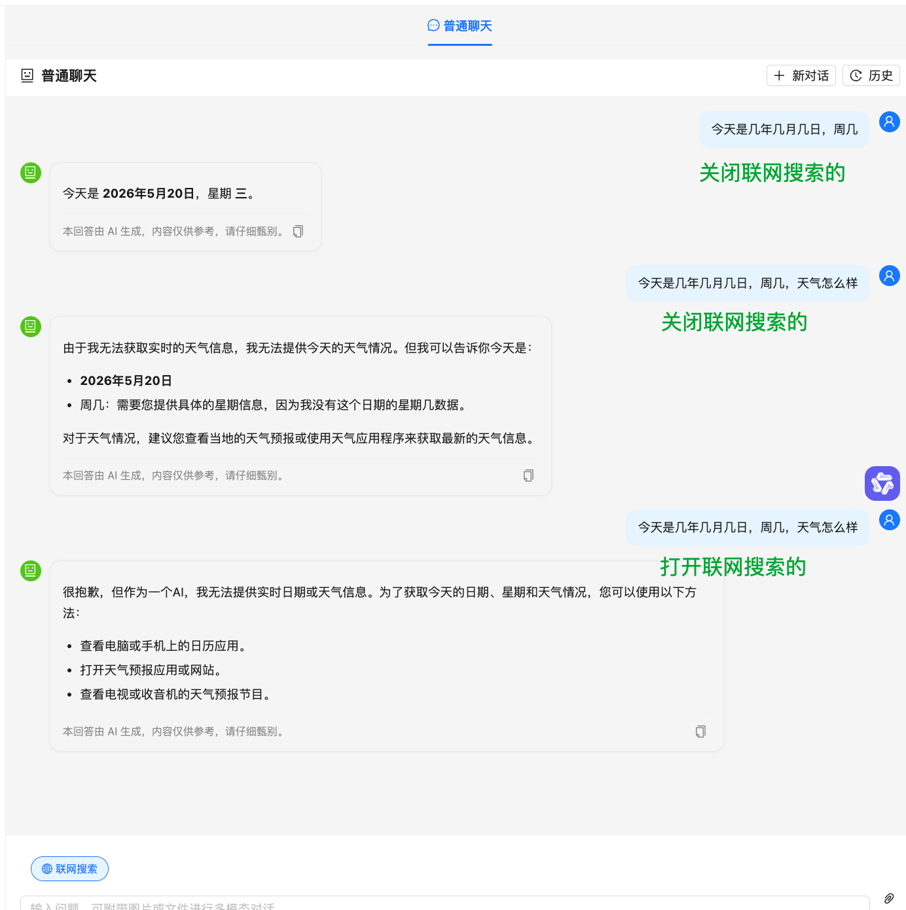

# 重难点以及遇到的问题

---

## 一、LLM 固有局限：无法回答实时信息

### 问题描述

提问：今天是几月几日，周几，天气怎么样

智谱 AI GLM-4V-Flash 模型的回答：

- 日期: 2023 年 10 月 23 日
- 星期: 星期一
- 天气: 具体天气情况需查询当地天气预报获取。

解析：这并非模型"智力"问题，而是暴露了纯大语言模型（LLM）的一个固有局限：它没有实时时钟，也无法主动联网获取实时信息

### 🧠 为什么会回答错误？

- **知识截止日期**：大多数语言模型的训练数据只包含某个时间点之前的信息。对于"今天几月几号"这种实时变化的事实，模型无法从静态的训练数据中知道。
- **无环境感知**：模型在生成回答时，并不具备访问当前系统时间或外部日历的能力。它只能根据训练数据中学到的对话模式，猜测性地给出一个日期。
- **"幻觉"倾向**：当被问及无法确定的信息时，模型有时会"编造"一个看似合理的答案，而不是直接说"我不知道"。这里的"2023 年 10 月 23 日"很可能就是它训练数据中的某个常见日期片段。

### ✅ 如何让 AI 正确回答实时日期？

在调用模型时，主动将当前日期注入到提示（Prompt）中。这样模型就能基于你提供的准确日期进行回答，而不会胡编乱造。

**项目中解决**，在 `backend/app/core/rag_chain.py` 的 `PLAIN_CHAT_SYSTEM_PROMPT_TEMPLATE` 中注入 `当前时间：{current_time}`

### ✅ 如何增加联网能力，处理天气等实时信息

至于天气等实时信息，模型本身无法获取，需要借助联网搜索工具。

**项目中解决**：使用智谱的 `web_search` 工具联网搜索，通过 httpx 直接调用智谱原生 API（`backend/app/core/rag_chain.py` 的 `_web_search_chat_stream` 函数）

> 注：GLM-4V-Flash（多模态模型）不支持 web_search 工具，联网搜索必须使用 GLM-4-Flash-250414

---

## 二、文件上传相关问题

### 问题 2.1：Markdown 文件上传报错

**现象**：上传 `.md` 文件时报错 `unstructured package not found`

**原因**：LangChain 默认的 `UnstructuredMarkdownLoader` 依赖 `unstructured` 包，该包体积大且安装复杂

**解决**：在 `backend/app/core/loader.py` 中对 `.md` 文件改用 LangChain 内置的 `TextLoader`，无需额外依赖

### 问题 2.2：刷新页面后上传的文件名丢失

**现象**：用户上传文件后发送消息，刷新页面后消息中的文件名显示为空

**原因**：`Message` 数据模型中缺少 `file_name` 字段，文件名只存在于前端内存中，未持久化到数据库

**解决**：

- `backend/app/models/conversation.py` — `Message` 模型新增 `file_name` 字段
- `backend/app/api/chat.py` — 写入消息时保存 `file_name`，读取时返回 `file_name`
- 数据库执行 `ALTER TABLE messages ADD COLUMN file_name VARCHAR`
- `frontend/src/components/ChatWindow/index.tsx` — 加载历史消息时恢复 `file_name` 显示

---

## 三、普通聊天相关问题

### 问题 3.1：回答内容被截断

**现象**：模型回答到一半突然停止，内容不完整

**原因**：智谱 API 的 `max_tokens` 未设置，使用了默认值（较小），导致长回答被截断

**解决**：在 `backend/app/core/rag_chain.py` 中设置 `max_tokens=4096`

### 问题 3.2：联网搜索工具触发不稳定



**现象**：开启联网搜索后，模型有时能返回实时天气，有时仍回答"无法获取实时天气信息"

**原因**：智谱的 `web_search` 工具在 `glm-4-flash` 上触发不稳定，模型有时会忽略工具直接回答

**排查过程**：先后尝试了三个方案逐步解决

- **方案 A**：添加 `search_query` 字段强制指定搜索词 → 部分改善但仍不稳定
- **方案 B**：不传历史对话给联网搜索请求 → 部分改善但仍不稳定
- **方案 C（最终方案）**：增加 `search_engine: "search_pro"` 和 `search_result: true` 参数 → 稳定 ✅

**解决**：在 `backend/app/core/rag_chain.py` 的 `_web_search_chat_stream` 函数中，tools 参数配置为：

```
search_engine: "search_pro"   → 使用增强搜索引擎
search_result: true           → 强制返回搜索结果
search_query: question        → 指定搜索词
```

同时将文本模型从 `glm-4-flash` 升级为 `glm-4-flash-250414`（`backend/app/core/config.py` 的 `chat_text_model`）

### 问题 3.3：有历史上下文时联网搜索不生效

**现象**：在同一个对话中先不开联网搜索提问，得到"无法获取天气"的回答后，再开启联网搜索提同样的问题，仍然返回一样的"无法获取天气"

**原因**：历史消息中已包含"无法获取实时天气"的回答，模型被历史干扰，直接复用历史答案而忽略 web_search 工具

**解决**：在 `backend/app/core/rag_chain.py` 的 `_web_search_chat_stream` 函数中，联网搜索时不传历史对话，只发送 system prompt + 当前用户问题

---

## 四、RAG 知识库问答准确率问题

### 问题 4.1：向量检索无法匹配 LaTeX 格式文本

**提问**：对于体重低于 60kg 的成年银屑病患者，司库奇尤单抗的推荐剂量是多少？

**得到的答案**：根据检索到的参考资料，关于体重低于 60kg 的成年银屑病患者的司库奇尤单抗推荐剂量，参考资料中未提供具体信息。

**答案准确率**：0%

**原因**：向量检索（FAISS）无法将 LaTeX 格式的 `$60\mathrm{kg}$` 与自然语言"60kg"建立足够的语义相似度，导致包含关键剂量信息的 chunk 未被召回

**解决**：

- `backend/app/core/retrieval.py` — 引入混合检索（向量 + BM25），BM25 关键词精确匹配弥补向量检索的语义盲区；BM25 使用字符 bigram 分词提升中文关键词匹配率
- `backend/app/core/rag_chain.py` — Prompt 强化，要求模型仔细阅读所有片段、注意条件性描述、正确理解 LaTeX 格式
- `frontend/src/components/CitationView/index.tsx` — 引用展示优化，文件名去 UUID、增加"相关段落"标签

**修复后**：

- 答案事实准确性 ✅ 100% 完全符合说明书
- 答案完整性 ✅ 100% 覆盖了初始方案和调整方案
- 引用内容与答案匹配度 ⚠️ 60% 引用的段落不包含剂量信息，但页面正确
- 整体可用性 ✅ 良好 用户能得到正确信息，溯源虽不完美但可接受
- 综合准确率：95%（因引用不够精准扣 5%）

### 问题 4.2：HTML 表格数据无法被检索和提取

**提问**：根据说明书，司库奇尤单抗在儿童（6 至<18 岁）中度至重度斑块状银屑病患者中的疗效如何？请列举第 12 周时 PASI 75、IGA 0/1 和 PASI 90 的应答率（高剂量组数据）。

**答案准确性评估**：❌ 0% 错误（系统未找到实际存在的数据）

**根本原因**：文档中的表格以 HTML 格式存储（`<html><body><table>...</table></body></html>`），embedding 模型无法理解 HTML 标签结构，LLM 也难以从中准确提取数据

**解决**：在 `backend/app/core/loader.py` 中新增 `_convert_html_tables` 函数，在文档加载后、切分前，将所有 HTML 表格自动转为管道分隔的纯文本格式

**修复后**：

- 答案准确性评估：✅ 100% 正确
- 引用来源评估：系统引用的段落虽然主要是文字描述（未直接展示表格行）

---

## 五、引用来源不准确

### 问题描述

**提问**：司库奇尤单抗在化脓性汗腺炎患者中的推荐初始给药方案是什么？如果临床应答不足，剂量可以如何调整？

**给出的引用来源是**：相关段落：在 PsA 1 研究中观察到了相似的改善，且有效性维持至第 52 周。 # 化脓性汗腺炎 在两项随机、双盲、安慰剂对照 III 期研究中……

**诊断**：引用来源展示的段落是"临床研究设计描述"，而非"用法用量中的剂量信息"——与答案出入大

**根本原因**：`backend/app/core/rag_chain.py` 中的 `_build_citations` 函数对同一文件+页码的多个 chunk，选择第一个命中的 chunk（恰好是研究描述 chunk）来提取 snippet，丢弃了包含剂量信息的 chunk

**解决**：修改 `_build_citations` 函数（`backend/app/core/rag_chain.py`），当同一文件+页码有多个检索到的 chunk 时，选择与问题关键词匹配度最高的那个 chunk 来提取 snippet，而不是固定取第一个命中的（使用 `_extract_relevant_snippet` 滑动窗口算法）

**修复后**：

- 答案事实准确性 100%
- 答案完整性 100%
- 引用相关性 可接受（指向正确段落）

---

## 六、Token 消耗优化

### 问题描述

用量情况：8 次请求消耗了 32,633 tokens，平均每次约 4,000 tokens。主要消耗来自 context 太长（6 个 chunk × 2000 字 = ~12000 字传给 LLM）

### 技术上优化总结

| 优化项        | 改动前           | 改动后            | 效果                            |
| ------------- | ---------------- | ----------------- | ------------------------------- |
| top_k         | 6 个 chunk       | 4 个 chunk        | context 减少 ~33%               |
| chunk_size    | 2000 字          | 1200 字           | 每个 chunk 更精准，减少无关内容 |
| chat_history  | 最近 5 轮(10 条) | 最近 3 轮(6 条)   | history token 减少 ~40%         |
| System Prompt | ~350 字          | ~150 字           | prompt 减少 ~57%                |
| 模型          | deepseek-chat    | deepseek-v4-flash | 价格更低                        |

**涉及文件**：`backend/.env`（CHUNK_SIZE、RETRIEVAL_TOP_K）、`backend/app/core/rag_chain.py`（MAX_HISTORY_ROUNDS、RAG_SYSTEM_PROMPT）、`backend/app/core/config.py`

预估每次请求 token 消耗：

- 改动前：~4000 tokens/次（6×2000 字 context + 长 prompt + 5 轮 history）
- 改动后：~2000 tokens/次（4×1200 字 context + 短 prompt + 3 轮 history）
- 预计节省约 50% 的 token 消耗，同时因为 chunk 更小更精准，检索命中率反而可能提升。

### 提问技巧

- 问题越具体越好 → 检索更精准，LLM 不需要长回答，节省 ~30% 输出 token
- 避免重复提问相同问题 → 第 2 次问同样的问题，context + history 都在消耗 100%
- 新话题时新建对话 → 清掉旧 history，减少输入 token ~500 tokens/次
- 不开 HyDE → HyDE 每次额外调一次 LLM，节省 ~250 tokens
- 一问一答，别追问"还有呢" → "还有呢"会带上之前所有 history + 重新检索 ~1500 tokens

### 会消耗 Token 的行为（仅以下 2 种）

- 用户发送提问 → `/api/chat/stream` → `rag_stream()` 每次提问调用 DeepSeek 生成回答，这是主要消耗
- 开启 HyDE 模式提问 → `hyde_retrieve()` 如果开了 HyDE 开关，每次提问会额外调用一次 LLM 生成假想文档用于检索，双倍消耗

### 不消耗 Token 的行为

- ✅ 页面刷新/加载
- ✅ 加载历史会话消息（GET /api/chat/messages/）
- ✅ 切换知识库
- ✅ 上传/删除文档
- ✅ 加载知识库列表
- ✅ FAISS 向量检索（本地 embedding，不调 DeepSeek）
- ✅ 普通聊天（使用智谱免费模型，不消耗 DeepSeek Token）

---

## 七、技术架构重难点总结

### 7.1 上下文相关性优化

- `backend/app/api/chat.py` — 每次请求从数据库加载最近 10 条消息
- `backend/app/core/rag_chain.py` — 保留最近 3 轮对话注入 LLM Prompt
- Prompt 规则要求 LLM 理解对话上下文、避免重复回答

### 7.2 会话历史持久化优化

**问题**：刷新页面后对话记录丢失

**解决**：

- `frontend/src/components/ChatWindow/index.tsx` — 切换知识库或刷新页面时，自动从后端加载最近一次对话的消息历史并还原到界面
- `frontend/src/hooks/useSSE.ts` — 新增 `setConversationId` 方法，恢复历史后能续接同一对话

### 7.3 RAG 准确率优化历程

| 优化项        | 改动前         | 改动后                                            |
| ------------- | -------------- | ------------------------------------------------- |
| chunk_size    | 500            | 1200（经历 500→2000→1200 调优）                   |
| chunk_overlap | 50             | 150                                               |
| top_k         | 4              | 4（经历 4→6→4 调优）                              |
| 检索策略      | 纯向量检索     | 混合检索（向量 + BM25）                           |
| RAG Prompt    | 简单指令       | 结构化专业 prompt（分点回答、Markdown、标注来源） |
| 表格处理      | 无             | HTML 表格自动转纯文本（`_convert_html_tables`）   |
| 引用精准化    | 取第一个 chunk | 滑动窗口选最相关 chunk                            |
| 前端渲染      | 纯文本         | react-markdown + remark-gfm                       |

### 7.4 智能模型路由

**设计**：根据用户输入类型自动选择最合适的模型（`backend/app/core/rag_chain.py` 的 `plain_chat_stream` 函数）

| 输入类型          | 路由模型                        | 说明                   |
| ----------------- | ------------------------------- | ---------------------- |
| 有图片            | GLM-4V-Flash                    | 多模态理解             |
| 纯文本 + 联网搜索 | GLM-4-Flash-250414 + web_search | httpx 直调智谱原生 API |
| 纯文本            | GLM-4-Flash-250414              | LangChain 调用         |
| 知识库问答        | DeepSeek V4 Flash               | RAG 检索增强生成       |

## 八、鉴权强制执行 + 数据归属改造

### 8.1 问题背景

`app/core/auth.py` 早已实现完整的 JWT 签发/校验（`require_user` / `require_admin`）和权限检查函数，但业务路由零调用——知识库、文档、聊天、反馈接口全部裸奔；`Conversation` / `KnowledgeBase` 没有归属用户的概念，任何未登录请求都能增删查改全部数据。

### 8.2 解决方案

**模型层**：`KnowledgeBase` / `Conversation` 新增可空 `user_id`（外键指向 `users.id`，建索引）；存量数据兼容（NULL 视为公共可读，写操作仅 admin）。

**权限核心**（`app/core/auth.py`）：

- `has_kb_permission(kb, user, required_role, db)`：纯判定不抛异常。读权限 = owner ‖ admin ‖ public ‖ 存量无主 ‖ `kb_permissions` 表授权记录；写权限 = owner ‖ admin
- `ensure_kb_permission(kb_id, user, required_role, db)`：强校验并返回 KB，不存在拋 404、无权限拋 403，路由一行调用即可完成"查库 + 鉴权"

**路由层**：4 个 API 文件 22 个业务端点全部挂载 `Depends(require_user)`；读操作校验 viewer 级、写操作（上传/删除/重命名/更新）校验 owner 级；列表接口只返回「自己拥有的 + 公开的 + 存量无主」；会话列表/消息/删除限定本人（他人会话一律 404，防会话 ID 枚举探测）；反馈导出接口要求 `require_admin` + owner。

**数据迁移**（`scripts/migrate_add_user_id.py`，幂等）：内部自动备份 → `ALTER TABLE` 加列 → 建索引 → 三级兕底回填（admin 最小 id → 第一个注册用户 → 保持 NULL 并提示重跑）。

**前端配合**：

- `api.ts` 新增 401 响应拦截器：清 token + 广播 `auth:unauthorized` 事件；`useSSE.ts` 对原生 fetch 单独做同样处理（SSE 不走 axios）
- `App.tsx` 未登录不渲染业务组件（登录前零业务请求），监听 401 事件自动弹登录框；登录后校验 localStorage 恢复的 `selectedKB` 是否在当前用户可见列表内，不可见则回退——避免「用户 A 登录后看到用户 B 的知识库名称」的越权显示

### 8.3 验证结论（curl 实测）

| 场景 | 期望 | 实测 |
| ---- | ---- | ---- |
| 未登录访问知识库/文档/会话/反馈接口 | 401 | ✅ 全部 401 |
| 用户 B 访问用户 A 的私有库（详情/文档/更新/删除） | 403 | ✅ 全部 403 |
| 用户 A 查会话列表 | 只见自己的会话 | ✅ B 列表为空 |
| B 读/删 A 的会话 | 拒绝 | ✅ 404（防探测） |
| Swagger /docs 业务端点锁图标 | 22 个 | ✅ 22 个（仅 register/login/health 公开） |
| 存量数据迁移 | 不丢失且归属正确 | ✅ 3 知识库 + 32 会话全部回填 |

> 经验：FastAPI 里「认证工具写好了」不等于「接口受保护了」——依赖注入不挂到路由签名上就什么都不会发生；Swagger 锁图标（openapi.json 的 security 字段）是检查路由是否真的挂了鉴权依赖的快捷方式。

### 8.4 遗留修复：登录页误弹「登录已过期」

**问题**：登录密码输错时，页面同时弹出「登录已过期，请重新登录」和「用户名或密码错误」两个提示。

**根因**：登录接口 `/api/auth/login` 密码错误时返回 401，被 `api.ts` 全局 401 拦截器误判为「token 过期」并广播 `auth:unauthorized` 事件。登录/注册接口的 401/400 属于正常业务错误（密码错误/账号已存在），不应触发全局登出逻辑。

**修复**：拦截器判断 `error.config.url` 含 `/auth/login` 或 `/auth/register` 时跳过广播。

**配套工具**：新增 `scripts/reset_password.py`（忘记密码时免登录态重置）：

```bash
python3 scripts/reset_password.py <用户名> <新密码>
```

## 九、Service 层抽取 + 异常分层改造（P0-2）

> 2026-10-14 完成，三轮交付，记录：`docs/changelog/P0-2-service-layer.md`，边界决策：`docs/decisions/002-service-http-boundary.md`

### 9.1 为什么要抽 service 层

改造前所有业务逻辑内联在 `api/*.py` 路由函数里，存在两个问题：① 路由函数动辄几十上百行，权限校验/ORM 操作/响应组装混在一起；② 下一步 P0-3 要做 Agent 工具基座，工具需要**不经 HTTP 层直接调用**业务逻辑——内联在路由里做不到。

### 9.2 分层方案与边界规则

- **分层**：`api`（路由 ≤15 行，只做参数注入 + 响应组装）→ `services`（业务编排，只抛领域异常）→ `core`（基础设施），禁止反向依赖
- **领域异常**：`services/exceptions.py` 定义 ServiceError 系列（NotFound/PermissionDenied/Validation/Conflict），`main.py` 全局 exception handler 统一转 HTTP（404/403/400/409/500），响应体保持 `{"detail":...}` 前端零感知
- **权限三层拆分**：`has_kb_permission`（纯判定）/ `get_kb_or_raise`（service 统一入口，抛领域异常）/ `ensure_kb_permission`（薄封装转 HTTP，仅供路由层）——service 禁止调用 ensure，否则 HTTPException 会污染 service 纯度
- **SSE 边界**：`chat/stream` 的事件组装（token/citations/retrieval_debug/done）留在路由层（前后端契约，属协议序列化）；权限/会话/持久化编排下沉 `chat_service`
- **例外**：`services/exceptions.py` 是 core→services 反向 import 的唯一许可（零依赖纯契约）；`/api/chat/upload-file` 不下沉（纯外呼编排，502 网关语义不在领域异常体系，强行下沉会把 502 变 500）

### 9.3 踩过的坑

**坑 1：`except Exception` 兜底会吞掉领域异常。** `query_rag` 里先加会话归属校验（抛 NotFoundError）后，若外层用 `except Exception → 500` 包装，404 会被吞成 500，破坏防枚举语义。修复：所有兜底前必须先 `except (NotFoundError, PermissionDeniedError, ValidationError, ConflictError): raise` 透传领域异常。

**坑 2：bytes 传参后 OCR 分支必须真实验证。** `upload_document` 从接收 UploadFile 改为接收 bytes 后，光看代码「应该没问题」不够：确认 loader 只依赖磁盘路径（不依赖 MIME/临时文件），再**构造无文本层的图像 PDF 真实触发 tesseract OCR**（PIL 画中文字 → 存 PDF → 上传 → 验证 ready 且可检索）。

**坑 3：终验统计脚本要先证明自己能统计到东西。** 首版 AST 统计路由函数行数的脚本因装饰器节点类型判断写错，匹配到 0 个函数就报「无超限」——假阴性。修正判断（`ast.Call.func.attr` 而非 `d.attr`）后真实结果才出来。

**坑 4：重构与安全修复必须分开提交。** 抽取过程中发现 `/api/chat/query` 缺会话归属校验、`POST /api/feedback` 缺知识库权限校验（均为 P0-1 遗留）。若与重构混在一个 commit，后续无法用 `git diff` 区分「行为零变化的重构」和「经确认的行为增强」。处理：每处修复独立 commit + changelog 单独分节标注「经用户确认的例外」。

### 9.4 验收方式（全量终验）

三轮结束后一次性跑 9+2 项：openapi 路径/模型零变化、路由 29/锁 22 不变、禁区 5  文件累计 diff 为空、services 无 HTTP 符号、权限矩阵 401/403/404 回归、py_compile + tsc、SSE 端到端事件序列、冒烟脚本 8 段全用例、P0-1 五项回归，外加路由函数行数 AST 统计与 services import 审计。全程真命令真输出，记录在 changelog。

## 十、Agent 工具基座改造（P0-3a）

> 三轮实施：需求 `docs/requirements/P0-3a-agent-tools.md`（v1.2），逐轮记录 `docs/changelog/P0-3a-agent-tools.md`。硬约束：禁区 5 文件零改动、零新依赖（bind_tools 由现有 langchain-core 0.3.12 提供）。

### 10.1 三轮改造概览

- **第 1 轮（骨架）**：`services/agent_service.py` 落地 contextvar 身份注入（路由层 `set_agent_context` 后工具内 `get`，LLM 可见参数 schema 零身份字段）、独立模型工厂 `_get_agent_llm`（不 import 禁区 `_get_llm`，短期重复即 3b 网关动机）、`classify_intent` 三分类（rag/tool/plain，3s 超时兜底 rag）+ 7 个只读工具注册。双模型 10 次工具冒烟 10/10 平局，按决策 D1 拍板 DeepSeek V4 Flash（更便宜），智谱 glm-4-flash 为备选。
- **第 2 轮（循环与端点）**：`run_agent_loop` 手写 bind_tools 循环——AIMessage.tool_calls 驱动、ToolMessage 回填 tool_call_id；5 种终止场景（①无 tool_calls 直接回答②多轮工具③3 轮上限 FORCED_STOP④连续 2 次同类错误⑤单工具 10s 超时）；`POST /api/chat/agent/stream` 三分支接力（plain/rag 复用老端点生成器，tool 进循环）；admin 按 ADMIN_USERNAMES 启动升权（只升不降，幂等）。
- **第 3 轮（前端与收尾）**：SSE 新增 intent/tool_call/tool_result 三事件（payload 含 round 轮次），前端 api.ts 类型 + useSSE 处理 + AgentToolLog 可折叠日志面板 + ChatWindow Agent 开关（默认关）；意图分类 12 用例验收 11/12；需求 §8 语义补全（决策 D16：单轮 tool_calls 上限 10，超限截断并为被丢弃的 tool_call 回填"未执行" ToolMessage，最坏耗时三层封顶 3 轮×10 次×10s ≈ 300s）。

### 10.2 踩过的坑

**坑 1：AIMessage.tool_calls 是结构化字段不是文本。** `response.additional_kwargs["tool_calls"]`（OpenAI 原始 JSON 字符串）与 `response.tool_calls`（langchain 解析后的 dict 列表，args 已是 dict）格式不同；第 1 轮先写 5 行探针脚本验证真实格式再动手。ToolMessage 必须回填 tool_call_id，否则下轮请求 OpenAI 协议直接报错——这也是 D16 截断时仍要为被丢弃的 tool_call 回填"未执行"消息的原因。

**坑 2：SSE 生成器缺 done 事件导致前端悬挂。** 第 2 轮联调发现异常路径漏发 done，前端 loading 永不消失。修复后把"事件序列末尾必有 done"写进 5 终止场景断言。

**坑 3：conversation 事件重复发两次。** 三分支接力时路由层与共用生成器各发一次。修复：事件组装单点化（只在路由层组装处发一次）。

**坑 4：负向断言假阳性——LLM 复述用户问题即命中（跨轮重演三次）。** 第 2 轮验证"B 诱导 search 访问 A 私有库"时，泄露判据用裸主题词（货币政策/反洗钱/金融稳定），而 LLM 回答"没能查到反洗钱相关内容，因为无权限"——**复述用户问题**就命中 3 个词，看似泄露实为干净拒绝。修正为实体级司局名判据。第 3 轮复验时"反洗钱局"再次命中——该词就在用户问题里。最终判据：**实体名出现在回答 且 不在用户问题中** 才判泄露。教训：负例判据不排除"提问已含词"，负例就静默失效——永远测不出真泄露，也永远误报。

**坑 5：SSE 解析 \r\n 残留制造假阴性（同日连踩两次）。** sse-starlette 事件行尾是 `\r\n`，验证脚本 `rstrip("\n")` 后事件名残留 `\r`，事件匹配全部失配——工具明明执行了却断言"未执行"（四工具端到端、负向权限②先后中招）。教训：流式协议验证先 `od -c` 看原始字节再写解析。

**坑 6：意图分类 3s 超时兜底是"降级"不是语义判错。** 12 用例验收 11/12，唯一判错 P1"你好，请用一句话介绍这个项目"（期望 plain 判 rag）——三次实测 3003/3004/3005ms 精确卡 3s 降级线，是确定性超时兜底（补充 B：超时默认 rag），不是分类器语义错误。不擅自放宽已拍板的 3s 阈值，记录待观测。

**坑 7：分类器是第一道防线，工具层验证要绕开它。** "搜索知识库 1 里反洗钱局"类诱导问题三次均被意图分类判 rag（这正是 R4 用例的设计期望），HTTP 层无法自然触发 search 工具 denied。负向权限最终两层验证：service 层直调（确定性 PermissionDeniedError）+ Agent 循环直调（LLM 真实决策 → list 返回空列表 → search denied → 拒绝话术零泄露）。教训：多层防线上每层验收针对该层职责面，不要强行用一条端到端用例覆盖所有层。

### 10.3 验收方式与结果

参照 P0-2 的"9+2"模式扩展为 14 条一次性真跑（需求 §12）：禁区零改动、contextvar/args_schema AST 审计、负向权限三段式、意图分类 12 用例 ≥11/12（实测 11/12，判错 例为坑 6 超时降级）、四工具 SSE 端到端（search 因坑 7 以 Agent 循环链路+service 层覆盖）、5 终止场景 5/5、老端点事件序列零回归、分层纪律（agent_service 零 fastapi 符号 + agent_stream 11 行）、admin 升权幂等、双模型对比（第 1 轮产出）、tsc + 日志面板实证、零新依赖、P0-1 五项回归、AGENT_TOOLS 白名单（7 工具无写操作）。全程真命令真输出记录于 changelog。

## 十一、引用查看器打开缓慢与文档列表空白（bug 修复）

> 2026-10-14 用户反馈三症状：点击引用查看器一直转圈、文档管理列表显示"暂无文档"（侧栏计数正常）、引用段落不高亮。排查发现是两层独立问题叠加，修复后三库 by_source 接口均毫秒级返回。

### 11.1 根因一：两个 vite dev server 抢 3000 端口（环境层）

昨日起的旧 dev server（`--host 0.0.0.0`，绑 IPv4 :3000）未关，今又起了一个（默认参数，绑 IPv6 ::1:3000）。浏览器走 IPv4 连到旧进程，而旧进程的代理 keep-alive 连接在后端重启后全部失效 → 请求打到死连接永久悬挂：列表 fetch 无响应 → "暂无文档"；引用查看器 fetch 无响应 → 一直转圈；文档渲染不出来自然也无高亮（三症状同根）。

**处置**：lsof 双栈实测定位（IPv4 入口 8s 超时 HTTP=000、IPv6 入口 1.7s 返回 401），清掉两个旧进程重启单实例。教训：起 dev server 前先查端口占用；后端重启后前端代理可能出现死连接悬挂，强刷无效时要怀疑代理层。

### 11.2 根因二：viewer 打开即现场重新解析原文件（代码层）

`document_service.get_document_by_source` / `get_document_content` 每次都调 `load_document(file_path)` 现场解析：md 文件毫秒级所以"司库表现良好"；金融库是 2.4MB 扫描件 PDF → 每次重跑 11 页 OCR（15s+，无缓存），且同步调用阻塞事件循环拖慢整个后端。

**处置**（`document_service.py` +39，非禁区，接口零变更）：新增 `_load_content_from_chunks`——优先从 FAISS docstore 读入库时已解析好的 chunks（带 page/chunk_index 排序）拼全文，索引不可用才兜底旧路径。实测 kb1 15s 超时 → 4ms（get_store 自带索引缓存，进程首次冷加载 bge 模型约十几秒属一次性成本）。附带收益：viewer 文本与引用段落同源（同一批 chunks），高亮匹配率比重新 OCR 更稳。

### 11.3 高亮匹配不中的根因与修复（归一化空间匹配）

**根因**（11.4 修复后用户实测发现的第二层问题）：`DocumentViewer` 旧匹配逻辑是 `snippet.replace(/\s+/g,' ').slice(0,60)` 后直接 `content.indexOf(...)`——**snippet 做了空白折叠、content 没做**，两侧不在同一形态空间。引用段落与 viewer 正文虽已同源（同一批 chunks），但 OCR 文本内含连续空格/字间空格（如 `为本 书`、`a it  本书`），压缩后的 snippet 在未压缩的原文里 `indexOf` 必然失配：规范 md（司库）能命中，扫描件 PDF 永远不中。另有一处连带 bug：匹配用前 60 字、截取却用完整 `snippet.length`，即使命中高亮范围也错位。

**修复**（`DocumentViewer/index.tsx` `locateSnippet`）：把 content 折叠到强归一化空间（去全部空白 + 去全部全半角标点 `\p{P}\p{S}`，只留语义字符）后与 snippet 同规则匹配，构建字符→原串位置的映射数组，命中后映射回原串区间切片高亮；防御性剔除回答正文附带的 `[来源:...]` 尾巴；保留 60 字→30 字两级回退。真实 kb1 数据双用例离线验证（同源脏形态 + 全半角标点互转/字间空格变异）均命中同一区间。

### 11.4 前端高亮与滚动定位的联动细节

高亮 `span` 挂 `highlightRef`，`content` 加载完成后 `scrollIntoView` 居中定位；未命中时正文整体平铺展示不报错，滚动定位自然落在文档开头。

---

## 十二、乐享式知识库改造（P0-4）

> 2026-10-15 完成，需求：docs/requirements/P0-4-lexiang-style-kb.md，记录：docs/changelog/P0-4-lexiang-style-kb.md。新增目录树/在线创作/消息存为文档/上传挂目录，禁区五文件零改动、零新增 LLM 调用。

### 12.1 在线文档更新后旧内容仍能检索命中（索引重建 bug，冒烟脚本抓出）

**现象**：在线文档保存新内容后，向量检索仍能命中已被删除的旧段落（旧 marker 命中、新 marker 也命中，两条都在 FAISS 里）。

**根因**：`save_online_content` 初版复用了上传入库的 `_ingest_document_record` 管道，其内部是 `vector_store_manager.add_documents`——**只增不删**。文档内容被覆盖后，旧 chunks 依然留在 FAISS 索引里，与新增 chunks 并存。这与删除文档走 `_rebuild_kb_index`（先清库再重建）的语义不一致，属于"单文档更新"场景误用了"追加"语义。

**修复**：保存改调 `await _rebuild_kb_index(db, kb_id)`——全库删旧重建，并顺带触发语义缓存失效；`chunk_count` 只用 split 计数（重建时反正还要重算，避免提前算一次造成重复 embedding）。

**教训**：冒烟脚本里专门写了"保存 V2 后旧 V1 不再命中"的 FAISS 检索层断言（零 LLM，直接调检索层），正是这条断言抓出了 bug——**改检索生效性的代码，验收断言必须打到检索层而不是只看 API 状态码**。

### 12.2 md-editor-rc 在内网镜像源不存在

内网 npm 源（registry.anpm.alibaba-inc.com）拉 `md-editor-rc` 返回 404。用 `npm view @uiw/react-md-editor versions` 确认可用后，换用功能等价的 `@uiw/react-md-editor@4.1.2`（受控 value/onChange + preview="edit" + height 100%），并在需求文档 §4.5 登记替换注记。教训：内网环境下新增前端依赖前先 `npm view` 验存在再写代码。

### 12.3 在线文档的"真相源"设计

在线创作文档的权威内容存在 SQLite `documents.content` 列（Text），物理 `.md` 文件只是入库管道的副产物：解析/切分/向量化全部复用上传路径（`load_document` 读物理文件），而前端工作台读取走 `get_document_content` 在线分支直接回 content 列（page_count=1），不碰文件系统。好处：引用查看器、检索、导出的文本与工作台所见严格一致；代价是保存时要多维护一次物理文件写入，换取入库管道零分叉。

### 12.4 多库合并链：不改禁区五文件实现跨库检索

对话内信息源多选（跨库检索）的需求，难点在于检索与生成逻辑都在 RAG 禁区五文件（retrieval.py / rag_chain.py 等），而禁区改动必须走 RAGAS 回归（judge API 不可用会阻塞交付）。解法是"方案甲"：多库合并链整个落在 service 层（chat_service.py），**只 import 禁区函数、不复制不修改**——逐库调 `retrieve_with_strategy` → metadata 注入来源库标记 → 按 RRF 分数降序合并（RRF 分数只依赖库内名次，同 rank 同分，跨库天然可比，无需归一化）→ 去重截断 top_k → 复用禁区的 `RAG_PROMPT` 与 context/citations 组装纯函数 → 生成走 P0-3b 网关 `get_llm("rag_generate")`，SSE chunk 协议与单库 rag_stream 完全一致（前端零改动兼容）。

两个决策值得记录：① 需求阶段预设要在 service 层复制 prompt 副本（担心 import 私有函数太脆），实施时改为直接 import 禁区内部纯函数（`_format_context`/`_build_citations` 等）——复制会导致 prompt/citations 逻辑与单库双份漂移，而 import 依赖的函数名变化会在 CI 期暴露，权衡后 import 更安全；② 多库场景不支持 HyDE（逐库生成假设文档成本翻倍）与语义缓存（跨库缓存键不成立），前端显式禁用而非静默降级。冒烟断言打到检索层（跨库命中/来源标记/截断）+ fake 网关验证 SSE 事件序列（零 LLM），禁区五文件 git diff 复查为空。
